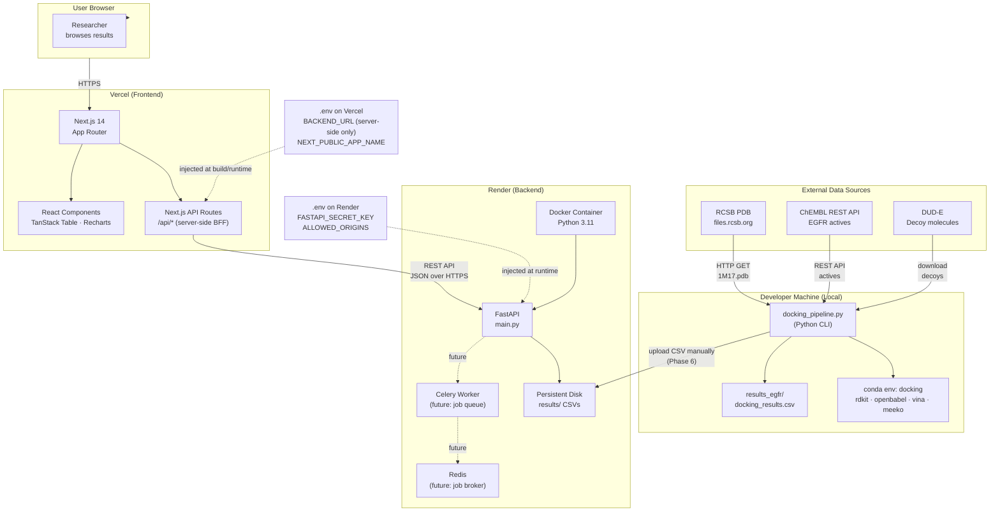

# Deployment Architecture Diagram
## High-Throughput Molecular Docking Pipeline

**Version:** 1.0  
**Last Updated:** 2026-11-07  
**Purpose:** This document is the blueprint for deploying the backend to Render and the frontend to Vercel, then connecting them.

---

## Full System Architecture



---

## Step-by-Step Deployment Guide

### Step 1: Prepare the Backend (Render)

**What you need:**
- A GitHub account with the repo pushed
- A Render account (render.com, free tier works)
- The `backend/` folder containing `main.py`, `Dockerfile`, `requirements.txt`

**Directory structure for backend:**

```
backend/
├── main.py          ← FastAPI app
├── Dockerfile       ← Container definition
├── requirements.txt ← fastapi uvicorn slowapi python-multipart
└── results/         ← mounted persistent disk (do not commit data here)
```

**Dockerfile:**

```dockerfile
FROM python:3.11-slim

WORKDIR /app

COPY requirements.txt .
RUN pip install --no-cache-dir -r requirements.txt

COPY main.py .

EXPOSE 8000

CMD ["uvicorn", "main:app", "--host", "0.0.0.0", "--port", "8000"]
```

**Deploy steps on Render:**

1. Push `backend/` to your GitHub repo
2. Go to render.com → New → Web Service
3. Connect your GitHub repo
4. Set:
   - **Root directory:** `backend`
   - **Build command:** `docker build -t app .`
   - **Start command:** (auto from Dockerfile)
   - **Environment:** Docker
5. Add environment variables in Render dashboard:
   - `FASTAPI_SECRET_KEY` = (generate with `python -c "import secrets; print(secrets.token_hex(32))"`)
   - `ALLOWED_ORIGINS` = `https://your-app.vercel.app`
6. Add a **Persistent Disk** mounted at `/app/results` (Render dashboard → Disks)
7. Click **Deploy**
8. Note your Render URL: `https://your-backend.onrender.com`

**Upload your CSV to the backend:**

```bash
# From local machine, after pipeline run:
curl -X POST https://your-backend.onrender.com/upload \
  -H "Authorization: Bearer YOUR_SECRET_KEY" \
  -F "file=@results_egfr/docking_results.csv" \
  -F "run_id=egfr_run1"
```

---

### Step 2: Prepare the Frontend (Vercel)

**What you need:**
- A Vercel account (vercel.com, free tier works)
- The `frontend/` folder containing a Next.js app
- Your Render backend URL from Step 1

**Directory structure for frontend:**

```
frontend/
├── app/
│   ├── layout.tsx
│   ├── page.tsx           ← landing
│   ├── results/
│   │   ├── page.tsx       ← results table
│   │   └── [run_id]/
│   │       └── page.tsx   ← single run detail
│   └── api/
│       └── runs/
│           └── route.ts   ← Next.js API route (BFF — calls Render)
├── components/
├── tailwind.config.ts
├── next.config.ts
└── package.json
```

**Environment variables for Vercel (set in dashboard, NOT in code):**

| Variable | Value | Visible in browser? |
|---|---|---|
| `BACKEND_URL` | `https://your-backend.onrender.com` | No — server-side only |
| `BACKEND_SECRET_KEY` | (same key set on Render) | No — server-side only |
| `NEXT_PUBLIC_APP_NAME` | `Docking Pipeline` | Yes — safe, not sensitive |

**Deploy steps on Vercel:**

1. Push `frontend/` to GitHub
2. Go to vercel.com → New Project
3. Import your GitHub repo
4. Set:
   - **Root directory:** `frontend`
   - **Framework preset:** Next.js (auto-detected)
5. Add environment variables in Vercel dashboard (not in `.env` file):
   - `BACKEND_URL` = `https://your-backend.onrender.com`
   - `BACKEND_SECRET_KEY` = (same value as Render)
   - `NEXT_PUBLIC_APP_NAME` = `Docking Pipeline`
6. Click **Deploy**
7. Your app is live at `https://your-app.vercel.app`

---

### Step 3: Connect Frontend to Backend

The frontend never calls the Render backend directly from the browser. It goes through a Next.js API route.

**How it works:**

```
Browser → GET /api/runs
        → Next.js API route (server-side, runs on Vercel)
        → GET https://your-backend.onrender.com/runs
           (with Authorization: Bearer BACKEND_SECRET_KEY)
        → returns JSON
        → Next.js forwards JSON to browser
```

**Example Next.js API route (`app/api/runs/route.ts`):**

```typescript
// This runs SERVER-SIDE on Vercel — BACKEND_URL is never sent to the browser
export async function GET() {
  const backendUrl = process.env.BACKEND_URL;       // server-side only
  const secretKey = process.env.BACKEND_SECRET_KEY; // server-side only

  const response = await fetch(`${backendUrl}/runs`, {
    headers: {
      Authorization: `Bearer ${secretKey}`,
    },
    next: { revalidate: 60 }, // cache for 60 seconds
  });

  const data = await response.json();
  return Response.json(data);
}
```

**Allow Vercel to call Render (CORS on FastAPI backend):**

```python
# In backend/main.py
from fastapi.middleware.cors import CORSMiddleware
import os

app.add_middleware(
    CORSMiddleware,
    allow_origins=[os.environ["ALLOWED_ORIGINS"]],  # only your Vercel URL
    allow_methods=["GET"],
    allow_headers=["Authorization"],
)
```

---

## Environment Variables Reference

### Never commit these. Set them in the platform dashboard only.

| Variable | Where set | Used by | Sensitive? |
|---|---|---|---|
| `FASTAPI_SECRET_KEY` | Render dashboard | FastAPI auth middleware | YES |
| `ALLOWED_ORIGINS` | Render dashboard | CORS middleware | No |
| `BACKEND_URL` | Vercel dashboard | Next.js API routes (server) | No, but keep private |
| `BACKEND_SECRET_KEY` | Vercel dashboard | Next.js API routes (server) | YES |
| `NEXT_PUBLIC_APP_NAME` | Vercel dashboard | Client-side React | No |

### `.env.example` (safe to commit — no real values):

```bash
# Backend (set these on Render dashboard)
FASTAPI_SECRET_KEY=replace-with-32-char-hex-secret
ALLOWED_ORIGINS=https://your-app.vercel.app

# Frontend (set these on Vercel dashboard)
BACKEND_URL=https://your-backend.onrender.com
BACKEND_SECRET_KEY=replace-with-same-32-char-hex-secret
NEXT_PUBLIC_APP_NAME=Docking Pipeline
```

---

## Security Checklist Before Going Live

- [ ] `FASTAPI_SECRET_KEY` is at least 32 random hex characters
- [ ] `ALLOWED_ORIGINS` on Render lists ONLY your Vercel domain (not `*`)
- [ ] `BACKEND_URL` is set in Vercel dashboard, not in `next.config.ts` or any client file
- [ ] `.env`, `.env.local`, `.env.*` are in `.gitignore`
- [ ] No environment variables with real values are in git history
- [ ] Render persistent disk is not publicly accessible
- [ ] FastAPI `/upload` endpoint requires `Authorization: Bearer` header
- [ ] Rate limiting is active on FastAPI (use `slowapi`)
